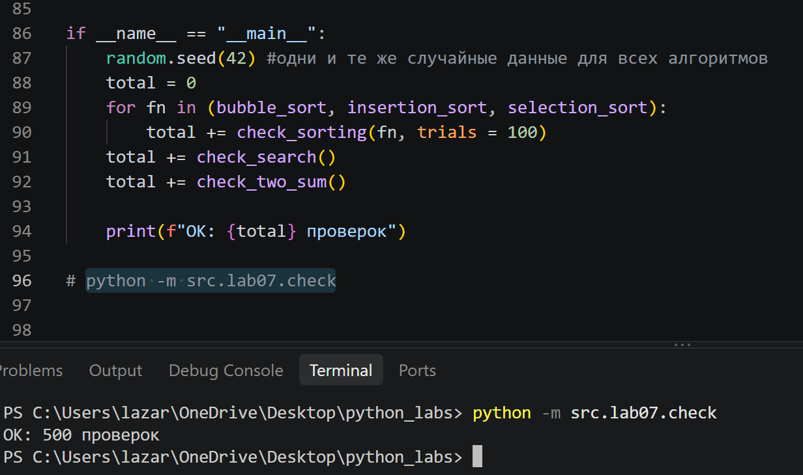

# ЛР7 — Поиск, сортировка и измерение времени

## Задание A: поиск

### linear_search
```python
def linear_search(nums: list[int], x: int) -> int:
    """Индекс первого вхождения x или -1.
 
    linear_search([4, 2, 7, 2], 2) -> 1
    linear_search([4, 2, 7, 2], 9) -> -1
    linear_search([], 1) -> -1
    """
    for i in range(len(nums)):
        if nums[i]==x:
            return i
    return -1
```
>- иду по списку циклом и беру индексы, возвращает позицию
>- если не нашел, возвращаем -1

### binary_search
```python
def binary_search(sorted_nums: list[int], x: int) -> int:
    """
    Индекс x в отсортированном по возрастанию списке или -1
    На неотсортированном списке результат не определён.
    Возвращает индекс найденного элемента или -1, если элемент отсутствует.

    binary_search([1, 3, 5, 7], 5) -> 2
    binary_search([1, 3, 5, 7], 4) -> -1
    binary_search([5], 5) -> 0
    binary_search([], 5) -> -1
    """
    lo = 0
    hi = len(sorted_nums)-1
    while lo <= hi:
        mid = (lo + hi)//2
        if sorted_nums[mid] == x:
            return mid
        elif sorted_nums[mid] < x:
            lo = mid + 1
        else:
            hi = mid -1
    return -1
```
>- ищет x, но работает только с отсортированным списком
>- границы `lo` и `hi`, где у `hi` -1 означает последний индекс
>- берем середину. если она больше искомого, отбрасываем правую половину, если меньше-левую
>- если не нашел, возвращаем -1

### two_sum_brute
```python
def two_sum_brute(nums: list[int], target: int) -> tuple[int, int] | None:
    """Пара индексов (i, j), i < j, nums[i] + nums[j] == target, или None.
    Принимает список чисел и целевую сумму target.
    Возвращает кортеж с индексами (i, j) или None, если пара не найдена.
    Метод полного перебора (O(n^2)).
 
    two_sum_brute([2, 7, 11, 15], 9) -> (0, 1)
    two_sum_brute([1, 2], 10) -> None
    """
    n = len(nums)
    for i in range(n):
        for j in range(i+1, n): # j идет после i, чтобы число не складывалось само с собой
            if nums[i] + nums[j] == target:
                return(i,j)
    return None
```
>- через два вложенных цикла перебираем числа
>- ищем два числа в списке, которые в сумме дают `target`

### two_sum_fast
```python
def two_sum_fast(nums: list[int], target: int) -> tuple[int,int] | None:
    """То же, что two_sum_brute
    Использует эффективный подход со словарём за один проход (O(n)).
    """
    seen = {} 
    for i, x in enumerate(nums):
        diff = target - x
        if diff in seen:
            return(seen[diff], i)
        seen[x] = i
    return None
```
>- заводим словарь `seen`, где числа в формате "значение:его индекс"
>- для каждого числа считаем `diff = target - x`, т.е какого числа не хватает
>- проверяем, есть ли уже это число в словаре
>- если не видели, записываем число и его индекс в словарь


## Задание B: сортировки

### bubble_sort
```python
def bubble_sort(nums: list[int]) -> list[int]:
    """Новый список, отсортированный по возрастанию. Исходный не меняется.
    Флаг flag дает ранний выход.
 
    bubble_sort([3, 1, 2]) -> [1, 2, 3]
    bubble_sort([2, 2, 1]) -> [1, 2, 2]
    bubble_sort([]) -> []
    """
    a = list(nums)
    n = len(a)
    for i in range(n):
        flag = False
        for j in range(0, n - i - 1):
            if a[j] > a[j+1]:
                a[j], a[j+1] = a[j+1], a[j]
                flag = True
        if not flag:
            break
    return a
```
>- создаем копию листа, чтобы не поменялись изначальные данные
>- многократно проходим по списку, сравнивая соседние элементы
>- меняем местами, если они стоят не по порядку
>- заводим флаг `flag`, если за проходи не было обменов, выходим через `break`

### insertion_sort
```python
def insertion_sort(nums: list[int]) -> list[int]:
    """Сортирует список методом вставок.
    Создает и возвращает новый отсортированный список, не меняя исходный.
    Принимает исходный, возвращает новый.
    """
    a = list(nums)
    for i in range(1,len(a)):
        key = a[i]
        j = i - 1
        while j>=0 and a[j]>key:
            a[j + 1] = a[j]
            j-=1 
        a[j + 1] = key
    return a
```
>- запоминаем элемент `key`. внутренний цикл `while` сдвигает все элементы, большие `key` вправо
>- как только мы находим элемент меньше `key`, мы ставим `key`сразу после него

### selection_sort
```python
def selection_sort(nums: list[int]) -> list[int]:
    """Сортирует список методом выбора.
    Создает и возвращает новый отсортированный список, не изменяя исходный.
    Принимает исходный, возвращает новый.
    Сложность O(n^2)
    """
    a = list(nums)
    n = len(a)
    for i in range(n):
        minidx = i
        for j in range(i + 1, n):
            if a[j] < a[minidx]:
                minidx = j
        a[i], a[minidx] = a[minidx], a[i]
    return a
```
>- делим список на две части: слева-отсортированная, справа-нет
>- на каждом шаге ищем минимальный элемент в неотсортированной части и меняем его местами с первым элементом этой части
>- обмен один раз за проход

## Задание C: проверка

### check_sorting
```python
def check_sorting(fn, trials: int = 100) -> int:

    for _ in range(trials):
        n = random.randint(0,50)
        nums = [random.randint(-100, 100) for _ in range(n)]
        original = list(nums)
        result = fn(nums)
        assert result == sorted(nums), f"{fn.__name__} ошиблась на {nums}: получено {result}, ожидалось {sorted(nums)}"
        assert nums == original, f"{fn.__name__} изменила исходный список"
    return trials
```
>- проверяем любую функцию сортировки против эталонного `sorted`
>- генерируем 100 случайных списков разной длины, сортируем и сравниваем
>- проверяем, что моя функция не изменила исходный список

### check_search (linear)
```python
def check_search(trials: int = 100) -> int:

    for _ in range(trials):
        n = random.randint(0,50)
        nums = [random.randint(-50,50) for _ in range(n)]
        x = random.randint(-60,60)

        # Линейный поиск против list.index
        try:
            expected_lin = nums.index(x)
        except ValueError:
            expected_lin = -1 #если числа нет, то правильный ответ(эталон) =-1
        actual_lin = linear_search(nums, x)
        assert actual_lin == expected_lin, f"linear_search ошиблась для поиска {x} в {nums}: получено {actual_lin}, ожидалось {expected_lin}"
```
>- генерируем 100 случайных списков разной длины
>- сравниваем результат с методом списков `index()`
>- если числа нет, перехватываем ошибку и выводим -1
>- проверяем, что моя функция не изменила исходный список

### check_search (binary)
```python
        sorted_nums = sorted(nums)
        try:
            expected_bin = sorted_nums.index(x)
        except ValueError:
            expected_bin = -1
        actual_bin = binary_search(sorted_nums, x)
        if expected_bin == -1:
            assert actual_bin == -1, f"binary_search не нашла элемент, которого нет: {x} в {sorted_nums}"
        else:
            assert actual_bin != -1 and sorted_nums[actual_bin] == x, f"binary_search вернула некорректный индекс {actual_bin} для {x} в {sorted_nums}"
    return trials
```
>- сортируем данные. если этого не сделать, программа найдет неверный ответ или упадет с ошибкой
>- проверяем, нашел ли алгоритм правильный индекс(или вернул -1, если элемента нет)

### check_two_sum
```python
def check_two_sum(trials: int = 100) -> int:

    for _ in range(trials):
        n = random.randint(2,30)
        nums = [random.randint(-30, 30) for _ in range(n)]
        target = random.randint(-50, 50)

        res_brute = two_sum_brute(nums, target)
        res_fast = two_sum_fast(nums, target)

        #если медленный ниечго не нашел, то быстрый тоже
        #если медленный нашел, то быстрый не пустой
        if res_brute is None:
            assert res_fast is None, f"two_sum_brute не нашла, а fast нашла {res_fast} для nums={nums}, target={target}"
            continue
        assert res_fast is not None, f"two_sum_brute не нашла {res_brute}, fast не нашла для для nums={nums}, target={target} "

        #если нашли, проверяем сумму
        if res_brute:
            i, j = res_brute
            assert nums[i] + nums[j] == target, f"brute вернул неверные индексы: {res_brute}"
            i,j = res_fast
            assert nums[i] + nums[j] == target, f"fast вернул неверные индексы: {res_fast}"
    return trials
```
>- генерируем 100 случайных списков разной длины и целевую сумму
>- запускаем оба алгоритма и проверяем, что оба дали одинаковый результат
>- если один ничего не нашел, то второй тоже должен быть `None`
>- если нашли индексы, проверяем сумму


