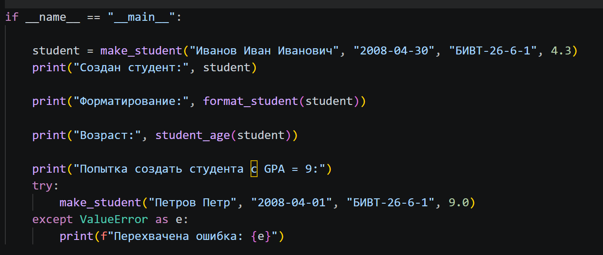
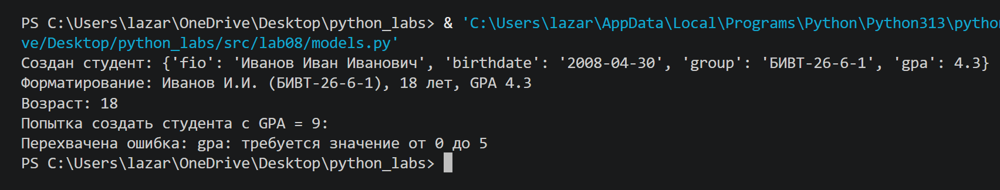
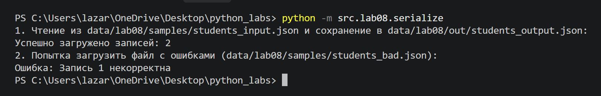

# ЛР8 - Модель данных без классов: запись Student как словарь, валидация и сериализация

## Задание A - Модель данных и функции (`models.py`)

`src/lab08/models.py` — запись студента как словарь с полями `fio`, `birthdate`, `group`, `gpa`

`src/lab08/serialize.py` — сохранение и загрузка студентов в JSON, чтение CSV

### Описание структуры записи и логики функций:

- **`validate_student(rec: dict) -> None`** - проверяет набор ключей, непустое ФИО, группу, существующую дату не из будущего и GPA от 0 до 5

```python
def validate_student(rec: dict) -> None:
    if not isinstance(rec, dict):
        raise ValueError('student должен быть словарем')
    
    if set(rec) != set(STUDENT_FIELDS):
        raise ValueError('нужны только поля fio, birthdate, group, gpa')

    for field in ('fio', 'group'):
        value = rec[field] # достаем значение по ключу
        if not isinstance(value, str) or not value.strip():
            raise ValueError(f'{field}: нужна непустая строка')
        
    birthdate = rec['birthdate']
    if not isinstance(birthdate, str):
        raise ValueError('birthdate должна быть строкой')
    try:
        birthday = date.fromisoformat(birthdate) #преобразовываем строку в объект даты
    except ValueError:
        raise ValueError('birthdate: неверная дата или формат')

    if birthday.isoformat() != birthdate: #проверка на строгий формат(добавляем недостающие нули)
        raise ValueError('нужен формат YYYY-MM-DD')

    if birthday > date.today():
        raise ValueError('birthdate: дата рождения не может быть в будущем')

    gpa = rec['gpa']
    if isinstance(gpa, bool) or not isinstance(gpa, (int, float)):
        raise ValueError('GPA должен быть числом (float или int)')
    if not (0 <= gpa <= 5):
        raise ValueError('gpa: требуется значение от 0 до 5')
```

- **`make_student(fio, birthdate, group, gpa) -> dict`** - создает запись, убирает пробелы по краям и приводит GPA к float

```python
def make_student(fio, birthdate, group, gpa) -> dict:
    '''Создаем проверенную запись студента'''
    rec = {"fio": fio, "birthdate": birthdate, "group": group, "gpa": gpa}
    rec['fio'] = fio.strip()
    rec['group'] = group.strip()
    rec['gpa'] = float(gpa)
    validate_student(rec)
    return rec
```

- **`student_age(rec: dict, today: date | None=None) -> int`** - вычисляет полные годы на заданную дату `today`(по умолчанию `date.today()`), учитывая, наступил ли уже день рождения в текущем году

```python
def student_age(rec: dict, today: date | None=None) -> int:
    '''Считаем полные годы на указанную дату'''
    if today is None:
        today = date.today()
    birthday = date.fromisoformat(rec["birthdate"]) #превращаем строку даты рожд. в объект даты
    age = today.year - birthday.year
    if (today.month, today.day) < (birthday.month, birthday.day):
        age-=1
    return age
```

- **`format_student(rec: dict) -> str`** - преобразует запись в читаемый вид. GPA с двумя знаками после точки

```python
def format_student(rec: dict) -> str:
    '''Форматируем запись студента в читаемую строку с инициалами и возрастом'''
    validate_student(rec)

    fio_parts = rec['fio'].split()
    surname = fio_parts[0].capitalize()
    initials = "".join(f"{part[0].upper()}." for part in fio_parts[1:])

    age = student_age(rec)
    return f"{surname} {initials} ({rec['group']}), {age} лет, GPA {rec['gpa']:.2f}"
```

- **`student_to_dict(rec: dict) -> dict`** - валидирует запись и возвращает ее независимую копию, предотвращая мутации данных

```python
def student_to_dict(rec: dict) -> dict:
    '''Возвращаем копию записи для сериализации'''
    validate_student(rec)
    return rec.copy()
```

- **`student_from_dict(d: dict) -> dict`** - осуществляет десериализацию словаря, приводит `gpa` к типу `float` и проводит строгую валидацию

```python
def student_from_dict(d: dict) -> dict:
    '''Десериализует словарь, приводит типы и проверяет запись через валидацию'''
    if not isinstance(d, dict):
        raise ValueError('Ожидался словарь для десериализации студента')

    fio = d.get('fio')
    birthdate = d.get('birthdate')
    group = d.get('group')
    gpa = d.get('gpa')

    if gpa is not None and not isinstance(gpa, bool):
        try:
            gpa = float(gpa)
        except (ValueError, TypeError):
            pass

    rec = {"fio": fio, "birthdate": birthdate, "group": group, "gpa": gpa}
    validate_student(rec)
    return rec
```

### Пример работы `models.py`:




---

## Задание B - Сериализация и политика обработки ошибок (`serialize.py`)

Модуль отвечает за экспорт и импорт данных в формате JSON. Расположен в `src/lab08/serialize.py`.

- **`students_to_json(students: list[dict], path: str | Path) -> None`** - выполняет сериализацию списка студентов в JSON-файл с предварительной валидацией каждого элемента. Параметры: `ensure_ascii=False`, `indent=2`

```python
def students_to_json(students: list[dict], path: str | Path) -> None:
    '''Сохраняем студентов в JSON'''
    data = [student_to_dict(student) for student in students]
    with Path(path).open('w', encoding = 'utf-8') as file:
        json.dump(data, file, ensure_ascii=False, indent=2)
```

-**`students_from_json(path: str | Path) -> list[dict]`** - читает JSON-файл, преобразует его в список и десериализует каждую запись.

```python
def students_from_json(path: str | Path) -> list[dict]:
    '''Загружаем список студентов из JSON-файла и проверяем каждую запись'''
    with Path(path).open(encoding = 'utf-8') as file:
        data = json.load(file)
    if not isinstance(data, list):
        raise ValueError('В JSON ожидается массив студентов')

    students = []
    for number, item in enumerate(data, start=1):
        try:
            # десериализация и строгая валидация
            student = student_from_dict(item)
        except ValueError:
            raise ValueError(f'Запись {number} некорректна')
        students.append(student)
    return students
```

### Политика обработки битых записей

Выбрана строгая политика `strict`: при обнаружении любой некорректной записи(битая дата, недопустимый gpa, лишние ключи) процесс прерывается с выбросом ошибки `ValueError`, содержащей индекс проблемной строки и причину ошибки.

### Пример работы serialize.py:



### Фрагмент записи JSON до и после преобразования:

[Входной JSON](/data/lab08/samples/students_input.json) -> [Полученный JSON](/data/lab08/out/students_output.json)

```text
До: 'gpa': 5
После: 'gpa': 5.0
```

### Запуск 

Из корня проекта
```
python -m src.lab08.serialize
```
Результат сохраняется в `data/lab08/students_output.json`
