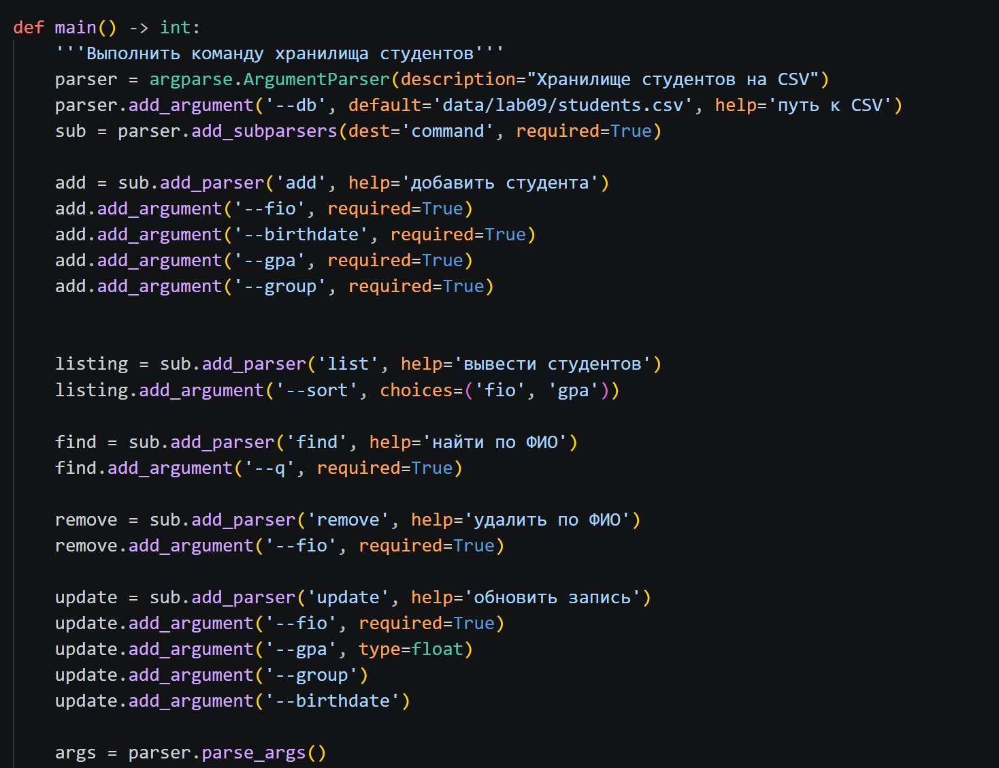
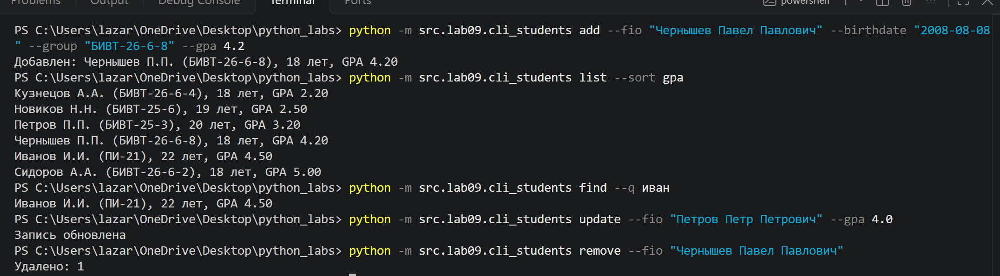
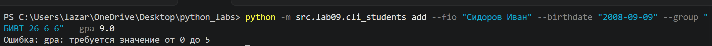

# ЛР9 — «База данных» на CSV: CRUD-функции над students.csv и CLI

`group.py` — хранилище студентов в CSV: добавление, список, поиск, обновление и удаление

`cli_students.py` — запуск операций через подкоманды argparse

## Задание A - Хранилище и CRUD (group.py)
Модуль работает с CSV-файлом как с простейшей базой данных студентов.

#### Служебные:

- **`ensure_storage(path: str | Path) -> None`** - создаёт файл с заголовком `fio,birthdate,group,gpa` (и недостающие папки), если его ещё нет

```python
def ensure_storage(path: str | Path) -> None:
    '''Создаем CSV с заголовком, если файла нет'''
    path = Path(path)
    if not path.exists():
        path.parent.mkdir(parents=True, exist_ok = True)
        with path.open('w', encoding='utf-8', newline='') as file:
            writer = csv.DictWriter(file, fieldnames=HEADER)
            writer.writeheader()
```

- **`load_students(path: str | Path) -> list[dict]`** - читает файл через `csv.DictReader`, каждую строку пропускает через `student_from_dict` (там же gpa из строки становится float) и выкидывает `ValueError` при неверном заголовке, лишних колонках или некорректной строке(в сообщении указывается номер строки файла).

```python
def load_students(path: str | Path) -> list[dict]:
    '''Читаем и проверяем всех студентов из файла
    (прочитать весь файл и вернуть список студентов)
    '''
    ensure_storage(path)
    students = []
    with Path(path).open('r', encoding='utf-8', newline='') as file:
        reader = csv.DictReader(file)
        if reader.fieldnames != list(HEADER):
            raise ValueError('CSV: нужен заголовок fio, birthdate, group, gpa')
        for number, item in enumerate(reader, start=1): # дает нам номер строки при ошибке
            try:
                student = student_from_dict(item)
            except ValueError as error:
                raise ValueError(f'Запись {number}: {error}') from error
            students.append(student)
    return students
```

- **`save_students(path: str | Path, students: list[dict]) -> None`** - отвечает за сохранение базы данных (списка студентов) обратно в CSV-файл. Проверяет список словарей и полностью перезаписывает в файл.

```python
def save_students(path: str | Path, students: list[dict]) -> None:
    '''Перезаписываем CSV с проверенными записями
    (сохранить измененный список студентов обратно в файл)
    '''
    for student in students:
        validate_student(student)
    path = Path(path)
    path.parent.mkdir(parents=True, exist_ok=True) #создаем папки, если их нет
    with path.open('w', encoding='utf-8', newline='') as file:
        writer = csv.DictWriter(file, fieldnames=HEADER)
        writer.writeheader()
        writer.writerows(students)
```

#### CRUD:

- **`add_student(path: str | Path, student: dict) -> None`** - валидирует запись, дописывает в конец. если она некорректна, `ValueError/TypeError` и файл не меняется. 

```python
def add_student(path: str | Path, student: dict) -> None:
    '''Добавляем студента без дубликатов по ФИО'''
    validate_student(student)
    students = load_students(path)
    for existing in students: #перебор по существующим студентам
        if existing['fio'] == student['fio']:
            raise ValueError('Студент с таким ФИО уже существует')
    students.append(student)
    save_students(path, students)
```

- **`list_students(path: str | Path, sort_by: str | None=None) -> list[dict]`** - список всех записей. Отсортированный по требованию. `sort_by` ∈ `{None, "fio", "gpa"}`. Сортировка по GPA по убыванию

```python
def list_students(path: str | Path, sort_by: str | None=None) -> list[dict]:
    '''Вернуть список студентов с необязательной сортировкой'''
    if sort_by not in (None, 'fio', 'gpa'):
        raise ValueError('sort_by: допустимы fio, gpa, None')
    students = load_students(path)
    if sort_by is not None:
        students = sorted(students, key=lambda student: student[sort_by]) #сортируем список и указываем, по какому ключу сортировать
    return students
```

- **`find_students(path: str | Path, substr: str) -> list[dict]`** - все записи,  у которых `substr` входит в `fio` без учёта регистра.

```python
def find_students(path: str | Path, substr: str) -> list[dict]:
    '''Найти по подстроке ФИО без учета регистра'''
    students = load_students(path)
    nizh = substr.casefold() # переводим искомую строку в нижний регистр
    return [student for student in students if nizh in student['fio'].casefold()] #возвращаем список студентов с нужным текстом в ФИО
```

- **`remove_student(path: str | Path, fio: str) -> int`** - удалить все записи с таким `fio`, вернуть количество удалённых

```python
def remove_student(path: str | Path, fio: str) -> int:
    '''Удалить все записи с указанным ФИО, вернуть количество удалений'''
    students = load_students(path)
    remaining = [student for student in students if student['fio'] != fio] #новый список тех, чье фио НЕ СОВПАДАЕТ с удаляемым
    removed = len(students)-len(remaining) #сколько записей было удалено
    if removed:
        save_students(path, remaining) #новый список без удаленных
    return removed
```

- **`update_student(path: str | Path, fio: str, **fields) -> bool`** - обновляет поля первой записи с таким ФИО, результат валидируется, возвращает `True/False`

```python
def update_student(path: str | Path, fio: str, **fields) -> bool:
    '''Обновить первую запись с указанным ФИО
    - результат валидируется
    - возвращает True, если запись найдена и обновлена, иначе False.
    '''
    for field in fields:
        if field not in HEADER:
            raise KeyError(field)
    students = load_students(path)
    for i, student in enumerate(students):
        if student['fio'] == fio:
            updated = dict(student)
            updated.update(fields)
            validate_student(updated)

            students[i] = updated
            save_students(path, students)
            return True
    return False
```


## Задание B - CLI (cli_students.py)

- Консольная утилита на `argparse` с подкомандами `add`, `list`, `find`, `remove`, `update`. Общий параметр `--db` с путём к хранилищу (по умолчанию `data/lab09/students.csv`).
- Список выводится по одной записи на строку через `format_student` из ЛР8.
- Ошибки валидации и повреждённый файл выводятся понятным текстом в stderr с кодом возврата 1



### Пример работы



### Формат хранилища
Файл `data/lab09/students.csv`, кодировка `UTF-8`, разделитель `,`, первая строка - заголовок
```python
fio,birthdate,group,gpa
Иванов Иван Иванович,2004-05-15,ПИ-21,4.5
Петров Петр Петрович,2006-03-20,БИВТ-25-3,4.0
Новиков Николай Никитич,2007-09-30,БИВТ-25-6,2.5
Сидоров Артем Александрович,2008-08-08,БИВТ-26-6-2,5.0
Кузнецов Артем Артемович,2008-06-06,БИВТ-26-6-4,2.2
```

### Обработка ошибок




